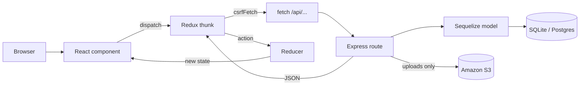
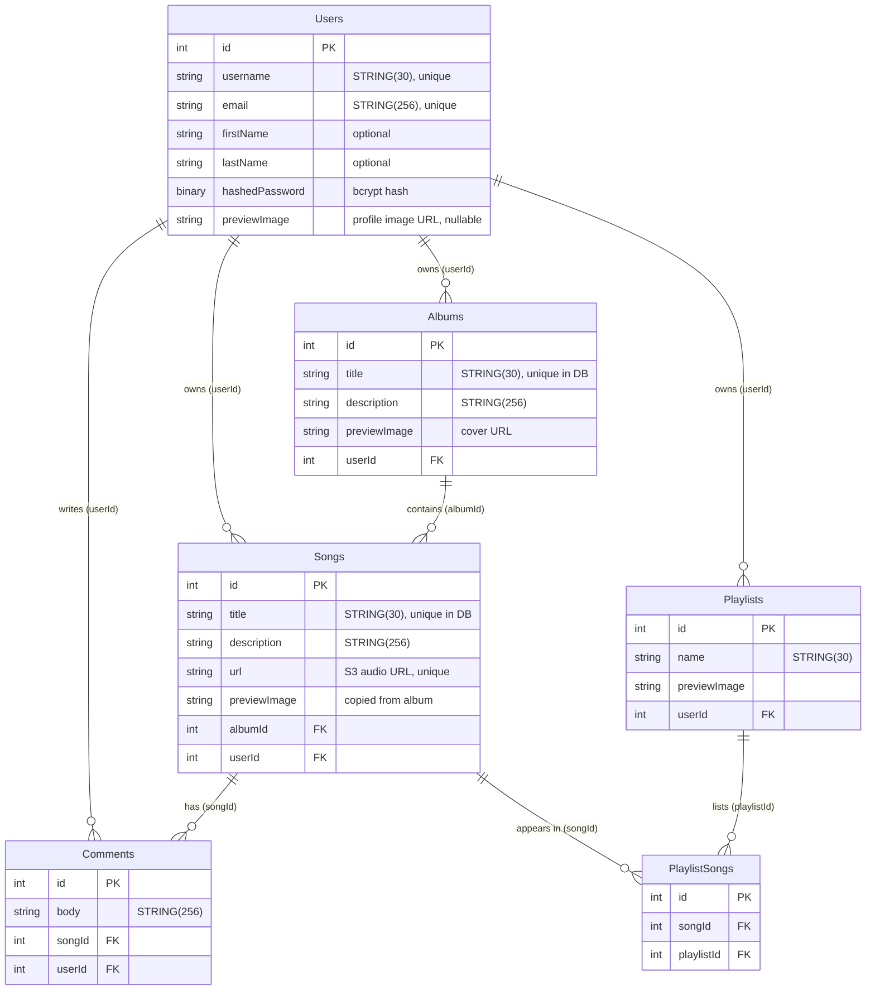
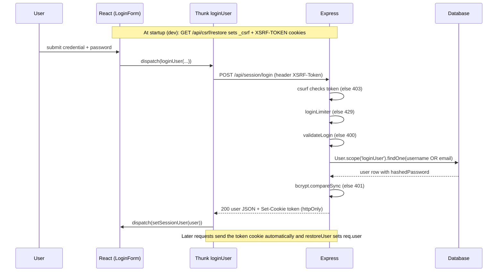
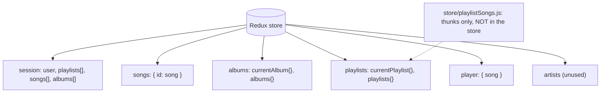
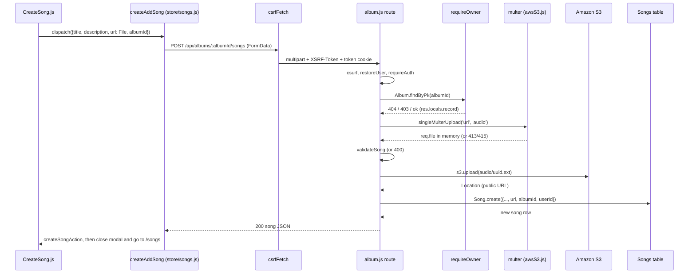

# SoundHaze: Guided Code Walkthrough

A tour of the SoundHaze codebase (a SoundCloud clone) as it is **today on the `modernize` branch**, after the Batch 1 fixes (S1 to S13). Read it top to bottom once, then use it as a map when you debug or prepare for an interview.

Everything here was checked against the actual files. When this guide says "from reading the code", it means the behaviour was worked out by reading, not by running the app.

## Table of contents

1. [The app in one minute](#1-the-app-in-one-minute)
2. [Folder map](#2-folder-map)
3. [How to run it locally](#3-how-to-run-it-locally)
4. [Data model](#4-data-model)
5. [Backend tour](#5-backend-tour)
6. [Authentication and security flow](#6-authentication-and-security-flow)
7. [Frontend tour](#7-frontend-tour)
8. [Three end-to-end traces](#8-three-end-to-end-traces)
9. [Where do I look when...](#9-where-do-i-look-when)
10. [What changed in Batch 1 and what's coming](#10-what-changed-in-batch-1-and-whats-coming)
11. [Interview prep](#11-interview-prep)
12. [Glossary](#12-glossary)

---

## 1. The app in one minute

**What it does.** Visitors can browse songs, albums and playlists and play songs in a player bar at the bottom of the page. After signing up, logging in, or clicking **Demo**, a user can:

- create albums (with a cover image),
- upload songs into their own albums (audio files go to Amazon S3),
- create playlists and add any song to them,
- edit or delete only the things they own.

**The stack.**

| Layer | Technology | Where |
|---|---|---|
| UI | React 18 (still in legacy `ReactDOM.render` mode), React Router v5 | `frontend/src` |
| State | Redux 4 + redux-thunk (hand-written, not Redux Toolkit) | `frontend/src/store` |
| HTTP helper | `csrfFetch` (wraps `fetch`, adds the CSRF header) | `frontend/src/store/csrf.js` |
| API server | Express 4 | `backend/app.js`, `backend/routes` |
| ORM | Sequelize 6 (SQLite in development, Postgres in production) | `backend/db` |
| Files | AWS S3 via `aws-sdk` v2 and multer | `backend/awsS3.js` |
| Auth | JWT in an `httpOnly` cookie, CSRF token via `csurf` | `backend/utils/auth.js`, `backend/app.js` |

**How a request flows.** Every feature follows the same path:



In words: a component calls `dispatch(someThunk())`. The thunk calls `csrfFetch('/api/...')`. Express runs middleware, then the route handler, which asks a Sequelize model to read or write the database (and, for uploads, sends the file to S3 first). The JSON comes back, the thunk dispatches a plain action, the reducer builds new state, and every component using `useSelector` on that state re-renders.

---

## 2. Folder map

Skips `node_modules`, `frontend/build` and lockfiles. CSS files sit next to their components and are not listed one by one.

```text
SoundCloud-API-Project/
├── package.json              Root helper scripts only (dev:backend, dev:frontend, build, start). No dependencies.
├── README.md                 Old 2022/2023 README (Heroku link, screenshots). S53 rewrites it.
├── CHANGES.md                What Batch 1 changed, item by item, with verification steps.
├── MODERNIZATION_PLAN.md     The 55-item plan (S1 to S55).
├── docs/WALKTHROUGH.md       This file.
│
├── backend/
│   ├── package.json          Backend deps and scripts (start uses per-env -> nodemon or node).
│   ├── .sequelizerc          Tells sequelize-cli where config, models, migrations and seeders live.
│   ├── bin/www               Entry point: loads .env, checks the DB connection, then app.listen().
│   ├── app.js                Builds the Express app: middleware chain, routes, error handlers.
│   ├── awsS3.js              multer setup (limits, MIME types) + S3 upload helpers.
│   ├── psql-setup-script.js  Production build step: creates the Postgres schema named by SCHEMA.
│   ├── README.md             The original API spec from App Academy (partly out of date).
│   ├── config/
│   │   ├── index.js          Reads env vars (NODE_ENV, PORT, DB_FILE, JWT_SECRET, JWT_EXPIRES_IN).
│   │   └── database.js       Sequelize config: SQLite file in development, DATABASE_URL Postgres in production.
│   ├── db/
│   │   ├── models/           One file per table + index.js that loads them all and wires associations.
│   │   ├── migrations/       Six files that create the six tables, in order.
│   │   └── seeders/          Seven files: users, albums, 100 songs, playlists, comments, playlist songs.
│   ├── routes/
│   │   ├── index.js          Mounts /api; in production also serves the React build; dev-only /api/csrf/restore.
│   │   └── api/
│   │       ├── index.js      Runs restoreUser for every /api request, then mounts each router below.
│   │       ├── session.js    POST /login, DELETE /logout
│   │       ├── users.js      POST /signup (multipart, optional profile image)
│   │       ├── my.js         GET / (current user), /songs, /albums, /playlists for the logged-in user
│   │       ├── songs.js      Song list (paginated), detail, update, delete, comments
│   │       ├── album.js      Album CRUD + POST /:albumId/songs (the ONLY way to create a song)
│   │       ├── playlist.js   Playlist CRUD + add/remove songs
│   │       ├── comment.js    Edit/delete a comment
│   │       ├── artist.js     Public artist profile + their songs/albums/playlists
│   │       └── images.js     POST /upload: upload one image to S3, return its URL
│   └── utils/
│       ├── auth.js           setTokenCookie, restoreUser, requireAuth (JWT logic)
│       ├── ownership.js      requireOwner(Model, param): 404/403 before a write
│       ├── validation.js     handleValidationErrors, validateIdParam, forbiddenErr
│       ├── pick.js           pick(obj, allowedKeys): blocks mass assignment
│       └── rateLimit.js      loginLimiter, signupLimiter (10/min per IP)
│
└── frontend/
    ├── package.json          CRA (react-scripts) app; "proxy": "http://localhost:5000" for dev.
    ├── public/               index.html, default-avatar.svg, background images.
    └── src/
        ├── index.js          Creates the store, restores CSRF (dev), renders <Root/>.
        ├── App.js            Restores the session, then renders the route table + player.
        ├── context/Modal.js  ModalProvider + <Modal> (React portal).
        ├── store/            Redux: index.js (store setup), csrf.js, one file per slice.
        └── components/       One folder per feature (Songs, Albums, Playlists, Create*, Update*, ...).
```

---

## 3. How to run it locally

There is **no `.env.example` file yet** (S52 adds one). The variables below were collected from `backend/config/index.js`, `backend/config/database.js`, `backend/awsS3.js` and `backend/db/models/user.js`.

**Step 1. Prerequisites.** Node 22 or newer (every `package.json` has `"engines": { "node": ">=22" }`).

**Step 2. Create `backend/.env`** (it is git-ignored):

```dotenv
PORT=5000
DB_FILE=db/dev.db
JWT_SECRET=<any long random string, e.g. output of: openssl rand -base64 48>
JWT_EXPIRES_IN=604800        # seconds; 604800 = 7 days
# Only needed for uploads (song audio, album/playlist images, profile images):
AWS_ACCESS_KEY_ID=<your key>
AWS_SECRET_ACCESS_KEY=<your secret>
AWS_REGION=us-west-2         # the seed bucket lives in us-west-2; read by the AWS SDK itself
# Optional:
# DEFAULT_AVATAR_URL=/default-avatar.svg
# Production only: NODE_ENV=production, DATABASE_URL=postgres://..., SCHEMA=soundhaze
```

What each one does:

| Variable | Read in | Used for |
|---|---|---|
| `PORT` | `config/index.js` | Port Express listens on (default 5000). The frontend proxy expects 5000. |
| `DB_FILE` | `config/index.js` -> `config/database.js` | Path of the SQLite file in development. |
| `JWT_SECRET` | `config/index.js` -> `utils/auth.js` | Signs and verifies the login token. If missing, login fails at runtime (S15 adds a startup check). |
| `JWT_EXPIRES_IN` | same | Token lifetime in seconds, and the cookie's `maxAge`. |
| `AWS_*` | read automatically by `aws-sdk` | S3 uploads. The bucket name is hard-coded as `soundcloud-bucket` in `awsS3.js` (S18 moves it to env). |
| `DEFAULT_AVATAR_URL` | `db/models/user.js` | Image shown for users without a profile picture. |
| `NODE_ENV` | many places | `production` switches to Postgres, serves the React build, turns on secure cookies and `trust proxy`. |
| `DATABASE_URL`, `SCHEMA` | `config/database.js`, migrations, seeders | Production Postgres only. |

**Step 3. Install each app separately** (since S13, a root `npm install` installs nothing):

```bash
cd backend && npm install
cd ../frontend && npm install
```

**Step 4. Create and fill the database** (from `backend/`). `npx dotenv` (from the `dotenv-cli` dev dependency) loads `.env` first, so sequelize-cli knows `DB_FILE`:

```bash
cd backend
npx dotenv sequelize db:migrate
npx dotenv sequelize db:seed:all
```

To start over: `npx dotenv sequelize db:seed:undo:all && npx dotenv sequelize db:migrate:undo:all`, then migrate and seed again.

**Step 5. Start both apps** in two terminals (from the repo root):

```bash
npm run dev:backend    # backend: nodemon ./bin/www on http://localhost:5000
npm run dev:frontend   # frontend: CRA dev server on http://localhost:3000
```

You should see `Database connection success! Sequelize is ready to use...` and `Listening on port 5000...` in the backend terminal.

**Step 6. Open http://localhost:3000.** The CRA dev server forwards every unknown request (like `/api/...`) to port 5000 because of `"proxy"` in `frontend/package.json`. From the browser's point of view, everything is one origin, so cookies just work.

**Step 7. Log in.** Click **Demo** in the nav bar (it logs in as `Demo-lition` / `password`). Other seed accounts include `Los Lonley Boys` / `password2` (owner of the "Sacred" album and song 1), handy for testing ownership rules.

**Without AWS keys** everything works except uploads: creating a song, uploading an album/playlist image, or signing up *with* a profile image will fail with a 500 ("Missing credentials" in the backend log). Signup without an image works.

---

## 4. Data model

Six tables. The column types and constraints below come from the **migrations** (`backend/db/migrations/`), which define the real database. The **models** (`backend/db/models/`) describe the same tables to Sequelize at runtime and add associations and scopes.



Every table also has `createdAt` and `updatedAt` (default `CURRENT_TIMESTAMP`).

**How to read it.** A user owns albums, songs, playlists and comments. A song always lives in one album. Songs and playlists are **many-to-many**: one song can be in many playlists and one playlist has many songs. The join table `PlaylistSongs` stores each pairing.

### Notes per model

**`User`** (`backend/db/models/user.js`)
- Associations: `hasMany` Album, Playlist, Song, Comment (all by `userId`).
- Instance methods: `toSafeObject()` returns `{ id, username, email }` (this is what goes inside the JWT); `validatePassword(pw)` compares with bcrypt.
- Static methods: `login({ credential, password })` finds by username **or** email using the `loginUser` scope (the only one that includes `hashedPassword`), checks the password, then returns the user re-loaded with the `currentUser` scope. `signup(...)` hashes the password with `bcrypt.hashSync` and creates the user. `getCurrentUserById(id)`.
- Scopes: `defaultScope` and `currentUser` hide `hashedPassword` and timestamps; `loginUser` shows everything; `includedArtist` (public profile) also hides `email`; `includedInComment` shows only `id`, `username`, `previewImage`.
- `previewImage` has a **getter**: if the stored value is empty it returns `DEFAULT_AVATAR_URL` (default `/default-avatar.svg`).
- Model validations: username 4 to 30 characters and not an email; email must be an email; `hashedPassword` must be exactly 60 characters (a bcrypt hash).

**`Album`** (`album.js`)
- Associations: `belongsTo` User, `hasMany` Song (`albumId`).
- Scope `includedAlbum`: only `id`, `title`, `previewImage` (used when a song detail includes its album).
- Deleting an album deletes its songs (the migration's `onDelete: 'cascade'` on `Songs.albumId`).

**`Song`** (`song.js`)
- Associations: `belongsTo` Album and User; `belongsToMany` Playlist **through** `PlaylistSong`; `hasMany` Comment.
- Scope `noPlaylistSong` exists but nothing uses it.
- A song's `previewImage` is copied from its album when it is created (see `POST /api/albums/:albumId/songs`).

**`Comment`** (`comment.js`)
- Associations: `belongsTo` Song and User. No scopes. There is no comments UI yet (S34).

**`Playlist`** (`playlist.js`)
- Associations: `belongsToMany` Song through `PlaylistSong`; `belongsTo` User.
- Scope `noPlaylistSongs` exists but nothing uses it.

**`PlaylistSong`** (`playlistsong.js`)
- The join table. No associations of its own (the other two models declare the many-to-many). Scope `addSongs` hides timestamps; used in the response of "add song to playlist".

**`index.js`** is generated by sequelize-cli. It reads every file in the folder, calls each model's factory, then calls every `associate()`. That is why routes can do `const { Song, User } = require('../../db/models')`.

**Gotchas worth knowing:**
- `Albums.title` and `Songs.title` are **unique across the whole database** in the migrations. Two different users cannot both have an album called "Greatest Hits". This would surface as a 500 with "Validation error" (a `UniqueConstraintError` from Sequelize).
- `Playlists.userId` has no `onDelete: 'cascade'` in its migration, unlike the other foreign keys.
- `Songs.albumId` is nullable in the migration but `allowNull: false` in the model, so the model is stricter than the DB.
- There is no unique rule on `(playlistId, songId)`, so the same song can be added to a playlist twice (S25 plans to add one).

**Seed data** (`backend/db/seeders/`): 7 users (ids 1 to 5 in `demo-user`, plus 6 and 7), 7 albums, 100 songs (audio and images point at the `soundcloud-bucket` S3 bucket in `us-west-2`), 15 playlists, 2 comments, and playlist-song links. Seeders run in filename order, which is why the timestamps in the names matter.

---

## 5. Backend tour

### 5.1 Startup: `backend/bin/www`

`npm start` in `backend/` runs `per-env`, which picks `start:development` (`nodemon ./bin/www`, restarts on file changes) or `start:production` (`node ./bin/www`) based on `NODE_ENV`.

`bin/www` does four things in order:
1. `require('dotenv').config()` loads `backend/.env` into `process.env`. This must happen **first**, because `config/index.js` reads `process.env` the moment it is required.
2. Loads `app` from `app.js`.
3. Loads `db/models` and calls `sequelize.authenticate()` to check the database connection.
4. Only if that works, `app.listen(port)`. If the DB is unreachable it logs "Database connection failure." and the server never listens.

### 5.2 `backend/app.js`, middleware in order

Express runs middleware **top to bottom** for every request. Each one either answers the request or calls `next()` to pass it on. Here is the chain as it is now:

| # | Line(s) | Middleware | What it does | Why it is here |
|---|---|---|---|---|
| 0 | 2 | `require('express-async-errors')` | Patches Express so a rejected promise in an `async` handler goes to the error handlers. | Without it, a thrown error inside `async (req, res) => {}` would hang the request. Must be required before routes are defined. |
| 1 | 21-23 | `app.set('trust proxy', 1)` (production only) | Makes `req.ip` the real client IP from `X-Forwarded-For`. | The rate limiter counts by IP; behind a proxy every request would otherwise look like the proxy. Off in dev so the header can't be faked. |
| 2 | 25 | `morgan('dev')` | Logs each request (`POST /api/session/login 200 12 ms`). | First, so even failed requests are logged. |
| 3 | 26 | `cookieParser()` | Fills `req.cookies` from the `Cookie` header. | `csurf` (cookie mode) and `restoreUser` both read cookies, so it must come before them. |
| 4 | 29-30 | `express.urlencoded` / `express.json` (100 KB limit) | Parses form and JSON bodies into `req.body`. | Routes and validators read `req.body`. Multipart uploads are **not** parsed here; multer does that inside specific routes. |
| 5 | 33-36 | `cors()` (development only) | Allows cross-origin requests. | In dev the CRA proxy already makes requests same-origin, so this is a safety net. Not used in production. |
| 6 | 40-63 | `helmet({...})` | Sets security headers: HSTS, `nosniff`, `X-Frame-Options`, `Referrer-Policy`, a Content-Security-Policy, and `Cross-Origin-Resource-Policy: cross-origin`. COEP is turned off so S3 media still loads. | Headers must be set before any route sends a response. |
| 7 | 66-74 | `csurf({ cookie: {...} })` | Stores a CSRF secret in a `_csrf` cookie, adds `req.csrfToken()`, and **rejects any non-GET request without a valid token** (403 `EBADCSRFTOKEN`). | Must come after `cookieParser` (it needs cookies) and before `routes` (so every write is protected). |
| 8 | 76 | `app.use(routes)` | All routes from `routes/index.js`. | The actual app. |
| 9 | 79-85 | 404 catcher | Nothing matched: create a 404 error and pass it on. | Must be after all routes. |
| 10 | 87-94 | Sequelize error formatter | If the error is a Sequelize `ValidationError`, turn its `errors` into plain strings and set `title`. | Runs before the final handler so the JSON is readable. |
| 11 | 96-105 | Final error handler | Sends `{ title, message, errors, stack }` with `err.status` or 500. `stack` is `null` in production. | Error handlers have **four** arguments `(err, req, res, next)`; Express only calls them after `next(err)`. They must be last. |

**Why order matters, with examples:**
- Move `cookieParser` below `csurf` and every POST fails with 403, because `csurf` can't read its `_csrf` cookie.
- Move the 404 handler above `routes` and every request returns 404.
- Every API error in the app ends up in handler #11, so the JSON shape `{ title, message, errors: [...] }` is the same everywhere. The frontend's `getErrorMessages()` relies on that shape.

Unused imports at the top of `app.js`: `check`, `handleValidationErrors` and `forbiddenErr` are imported but never used.

### 5.3 `backend/routes/index.js`

- Mounts the API router at `/api`.
- **Production only:** serves `frontend/build/index.html` for `/` and any non-`/api` path, and sets an `XSRF-TOKEN` cookie each time (that is how the browser gets its CSRF token in production). Also serves static files from the build folder.
- **Development only:** `GET /api/csrf/restore` sets the `XSRF-TOKEN` cookie and returns `201 {}`. The frontend calls it once at startup.

### 5.4 `backend/routes/api/index.js`

Runs `restoreUser` for **every** `/api` request (so `req.user` is always set, or `null`), then mounts the routers: `/session`, `/users`, `/songs`, `/my`, `/albums`, `/artists`, `/comments`, `/playlists`, `/images`.

### 5.5 Every API endpoint

Legend: **Auth** = needs a logged-in user (`requireAuth`, else 401). **Owner** = must own the record. "requireOwner" means the helper returns 403 for non-owners; "where-clause" means the route looks the record up with `where: { id, userId: user.id }`, so non-owners get **404** instead of 403 (a known inconsistency, see CHANGES.md S2). All non-GET requests also need a valid CSRF token. Every `:xxxId` param must be a positive integer (`validateIdParam`, else 400).

**Session, users, current user**

| Method | Path | Auth | Owner | Handler file | Models | Response |
|---|---|---|---|---|---|---|
| POST | `/api/session/login` | no (rate-limited 10/min) | - | `session.js` | User | User object `{ id, username, email, firstName, lastName, previewImage }` + sets `token` cookie |
| DELETE | `/api/session/logout` | no | - | `session.js` | - | `{ message: 'success' }`, clears `token` cookie |
| POST | `/api/users/signup` | no (rate-limited 10/min) | - | `users.js` | User (+ S3 if image) | User object + sets `token` cookie; 409 on duplicate username/email |
| GET | `/api/my` | no (returns `{}` if logged out) | - | `my.js` | User | `{ currUser }` or `{}` |
| GET | `/api/my/songs` | yes | - | `my.js` | Song | `{ Songs: [...] }` |
| GET | `/api/my/albums` | yes | - | `my.js` | Album | `{ Albums: [...] }` |
| GET | `/api/my/playlists` | yes | - | `my.js` | Playlist | `{ Playlists: [...] }` |

**Songs and comments**

| Method | Path | Auth | Owner | Handler file | Models | Response |
|---|---|---|---|---|---|---|
| GET | `/api/songs?page&size&title&createdAt` | no | - | `songs.js` | Song | `{ Songs, page, size, total }` (default size 20, max 100) |
| GET | `/api/songs/:songId` | no | - | `songs.js` | Song, Album, User | Song + `Album` (id, title, previewImage) + `Artist` (public user) |
| PUT | `/api/songs/:songId` | yes | requireOwner | `songs.js` | Song | Updated song (only `title`, `description`, `previewImage` change) |
| DELETE | `/api/songs/:songId` | yes | where-clause | `songs.js` | Song | `{ message: "Successfully deleted.", statusCode: 200 }` |
| GET | `/api/songs/:songId/comments` | no | - | `songs.js` | Song, Comment, User | `{ Comments: [...] }`, each with `User` (id, username, previewImage) |
| POST | `/api/songs/:songId/comments` | yes | - (any song) | `songs.js` | Song, Comment | The new comment |
| PUT | `/api/comments/:commentId` | yes | where-clause | `comment.js` | Comment | Updated comment (only `body`) |
| DELETE | `/api/comments/:commentId` | yes | where-clause | `comment.js` | Comment | `{ message: "Successfully deleted", statusCode: 200 }` |

**Albums**

| Method | Path | Auth | Owner | Handler file | Models | Response |
|---|---|---|---|---|---|---|
| GET | `/api/albums` | no | - | `album.js` | Album | **Plain array** of albums |
| POST | `/api/albums` | yes | - | `album.js` | Album | New album. Body is JSON `{ title, description, imageUrl }` (all required) |
| GET | `/api/albums/:albumId` | no | - | `album.js` | Album, Song, User | Album + `Songs: [...]` + `Artist` |
| PUT | `/api/albums/:albumId` | yes | requireOwner | `album.js` | Album | Updated album. Same validator as create, so all three fields are required |
| DELETE | `/api/albums/:albumId` | yes | where-clause | `album.js` | Album (songs cascade) | `{ message, statusCode }` |
| POST | `/api/albums/:albumId/songs` | yes | requireOwner (before upload) | `album.js` | Album, Song + S3 | New song. **Multipart**: `title`, `description`, audio file in field `url` |

**Playlists**

| Method | Path | Auth | Owner | Handler file | Models | Response |
|---|---|---|---|---|---|---|
| GET | `/api/playlists` | no (public on purpose since S2) | - | `playlist.js` | Playlist | **Plain array** of playlists |
| POST | `/api/playlists` | yes | - | `playlist.js` | Playlist | `201` + new playlist. Body `{ name, imageUrl? }` |
| GET | `/api/playlists/:playlistId` | no | - | `playlist.js` | Playlist, Song, User | Playlist + `Songs: [...]` + `User` (public) |
| PUT | `/api/playlists/:playlistId` | yes | where-clause | `playlist.js` | Playlist | Updated playlist (`name`, `previewImage`/`imageUrl`) |
| DELETE | `/api/playlists/:playlistId` | yes | where-clause | `playlist.js` | Playlist | `{ message, statusCode }` |
| POST | `/api/playlists/:playlistId/songs` | yes | where-clause | `playlist.js` | Playlist, Song, PlaylistSong | `{ id, songId, playlistId }`. Body `{ songId }` |
| DELETE | `/api/playlists/:playlistId/songs/:songId` | yes | requireOwner | `playlist.js` | Playlist, PlaylistSong | `{ message, statusCode }`; 404 if the song isn't in it |

**Artists, images, CSRF**

| Method | Path | Auth | Owner | Handler file | Models | Response |
|---|---|---|---|---|---|---|
| GET | `/api/artists` | no | - | `artist.js` | User | Plain array of public users |
| GET | `/api/artists/:artistId` | no | - | `artist.js` | User, Song, Album | Public user + `totalSongs`, `totalAlbums` |
| GET | `/api/artists/:artistId/songs` | no | - | `artist.js` | User, Song | `{ Songs }` |
| GET | `/api/artists/:artistId/albums` | no | - | `artist.js` | User, Album | `{ Albums }` |
| GET | `/api/artists/:artistId/playlists` | no | - | `artist.js` | User, Playlist | `{ Playlists }` |
| POST | `/api/images/upload` | yes | - | `images.js` | S3 only | `{ profileImageUrl }` (the S3 URL; the name is historical, it's used for album and playlist covers too). Multipart field `image` |
| GET | `/api/csrf/restore` | no (dev only) | - | `routes/index.js` | - | `201 {}` + `XSRF-TOKEN` cookie |

Notes:
- There is **no `POST /api/songs`**. A song can only be created inside an album: `POST /api/albums/:albumId/songs`.
- Response shapes are inconsistent: some lists are plain arrays (`/api/albums`, `/api/playlists`, `/api/artists`), others are wrapped (`{ Songs }`, `{ Albums }`). Check the table before writing a reducer.
- The `/api/artists/*` endpoints are not used by the frontend today.
- In `POST /api/playlists/:playlistId/songs`, if **both** the playlist and the song are missing, `next()` is called twice (from reading the code). Harmless in practice, but untidy.
- `DELETE /api/comments/:commentId` does `res.status = 200`, which overwrites the `res.status` *function* with a number. It still works because `res.json` defaults to 200, but it's a bug S19 removes.

### 5.6 The `utils` folder

**`utils/auth.js`**
- `setTokenCookie(res, user)`: signs a JWT containing `{ data: user.toSafeObject() }` (id, username, email) with `JWT_SECRET`, valid for `JWT_EXPIRES_IN` seconds, and sets it as the `token` cookie: `httpOnly` always, `secure` and `SameSite=Lax` in production.
- `restoreUser(req, res, next)`: reads `req.cookies.token`, verifies it with `jwt.verify`. If valid, loads the user with the `currentUser` scope into `req.user`. If invalid or expired, `req.user` stays `null` (no error; it's not a gatekeeper). If the user no longer exists, it clears the cookie.
- `requireAuth`: an **array** `[restoreUser, check]`. The second function calls `next()` if `req.user` exists, otherwise creates a 401 "Authentication required" error. Because `routes/api/index.js` already runs `restoreUser`, routes with `requireAuth` actually verify the JWT and query the user **twice** per request.
- `requireProperAuthorize` is an empty array and not exported (dead code).

**`utils/ownership.js`** (added in S2)
- `requireOwner(Model, param, ownerField = 'userId')` returns middleware. It loads `Model.findByPk(req.params[param])`; 404 if missing, 403 if `record.userId !== req.user.id`, otherwise saves it on `res.locals.record` so the handler doesn't query again. Use it **after** `requireAuth`.

**`utils/validation.js`**
- `handleValidationErrors`: reads `validationResult(req)` from express-validator. If there are errors, builds a 400 error with `errors: [messages]` and **returns** `next(err)` (the missing `return` was the S4 bug). Every `validateXxx` array in the routes ends with it.
- `validateIdParam`: used with `router.param('songId', validateIdParam)` etc. Rejects ids that aren't positive integers with 400.
- `forbiddenErr(next)`: builds a 403. Imported in `app.js` but never called.

**`utils/pick.js`** (added in S3)
- `pick(obj, allowedKeys)` copies only the listed keys that are defined. Update routes call `record.update(pick(req.body, [...]))`, so a client cannot change `userId`, `albumId`, `id`, etc.

**`utils/rateLimit.js`** (added in S9)
- `loginLimiter` and `signupLimiter`: separate in-memory counters, 10 requests per minute per IP each. Over the limit: 429 with the usual `{ title, message, errors }` shape.

**`backend/awsS3.js`** (reworked in S8)
- `UPLOAD_RULES`: audio up to 20 MB (`audio/mpeg`, `audio/mp4`, `audio/x-m4a`); images up to 5 MB (`image/jpeg`, `image/png`, `image/webp`).
- `singleMulterUpload(fieldName, kind)`: multer middleware with `memoryStorage` (the file is held in RAM as `req.file.buffer`), the size limit and a MIME-type filter. Wrapped by `withMulterErrors`, which turns multer errors into 413 ("File is too large...") or 415 ("Unsupported file type...").
- `singlePublicFileUpload(file)`: calls `uploadToS3`, which uploads to bucket `soundcloud-bucket` with a key like `audio/<uuid>.mp3` or `images/<uuid>.png` and the right `ContentType`, and returns the public URL (`result.Location`). That URL is what gets saved in the DB.
- No `ACL: public-read` any more. New files are only publicly readable if the bucket has a public-read bucket policy (see CHANGES.md open question 2).
- `multiplePublicFileUpload`, `singlePrivateFileUpload`, `multiplePrivateFileUpload`, `retrievePrivateFile`, `multipleMulterUpload` are exported but unused (S18 removes them).

### 5.7 Leftovers in route files

Several route files contain unused imports, including `const app = require('../../app')` (a circular import: `app.js` requires the routes, which require `app.js`). It is harmless at runtime because the value is never used, but it stops you from `require`-ing a route file on its own in a script. `users.js` also has `const { route } = require('./my')`, which is unused. These are lint cleanup (S47).

---

## 6. Authentication and security flow

Two cookies and one header do all the work:

| Name | Kind | Set by | Readable by JS? | Purpose |
|---|---|---|---|---|
| `token` | cookie | `setTokenCookie` on login/signup | **No** (`httpOnly`) | The JWT that proves who you are. Sent automatically by the browser on every request. |
| `_csrf` | cookie | `csurf` | No (`httpOnly`) | The secret csurf uses to check tokens. |
| `XSRF-TOKEN` | cookie | `GET /api/csrf/restore` (dev) or serving `index.html` (prod) | **Yes** | The CSRF token value, so the frontend can copy it into a header. |
| `XSRF-Token` | request header | `csrfFetch` on every non-GET request | - | csurf compares it with the `_csrf` secret. |

**Why both?** The JWT cookie is sent automatically, which is convenient but means another website could trick your browser into sending a POST to SoundHaze with your cookie attached (cross-site request forgery). A malicious site can't read your `XSRF-TOKEN` cookie, so it can't put the right value in the header. csurf rejects such requests with 403.

### 6.1 Step by step

**App start (restore session)**
1. `frontend/src/index.js`: in development, calls `restoreCSRF()`, which does `GET /api/csrf/restore`. The response sets `_csrf` and `XSRF-TOKEN` cookies.
2. `App.js`: `useEffect` dispatches `sessionActions.getCurrUser()`, which calls `GET /api/my`.
3. Backend: `restoreUser` reads the `token` cookie. If valid, `req.user` is set and `my.js` returns `{ currUser }`; otherwise `{}`.
4. The thunk dispatches `setSessionUser(currUser)` (which is `undefined` when logged out). Then `App` sets `isLoaded = true` and renders the routes.

**Login**
1. `LoginForm` (or `DemoUser`) dispatches `loginUser({ credential, password })`.
2. `csrfFetch` sends `POST /api/session/login` with JSON and the `XSRF-Token` header.
3. Backend chain: `csurf` checks the token, then `loginLimiter` counts the attempt, then `validateLogin` checks the fields, then the handler calls `User.login()`. bcrypt compares the password with `hashedPassword`.
4. Success: `setTokenCookie(res, user)` sets the `token` cookie and the user JSON is returned. Failure: 401 "The provided credentials were invalid".
5. Frontend: `setSessionUser(user)` goes into `state.session.user`. `App.js`'s second `useEffect` sees `user` change and dispatches `myPlaylists()` and `myAlbums()`.

**Signup** is the same idea with `POST /api/users/signup`, but the body is `FormData` (multipart) because it can include a profile image. Order on the backend: `csurf` -> `signupLimiter` -> multer (`singleMulterUpload('image','image')`) -> `validateSignup` -> handler (`User.signup`, then `setTokenCookie`).

**Logout**: `ProfileButton` dispatches `logoutUser()`, which sends `DELETE /api/session/logout`. The server clears the `token` cookie; the reducer clears `user`, `playlists`, `songs`, `albums` from the session slice. Note that the JWT itself is not revoked: there is no server-side session list. Clearing the cookie is all that happens.

**Any protected request** (for example editing a song): `requireAuth` -> 401 if no valid token; `requireOwner` -> 404/403; validators -> 400; then the handler.

**Session length**: the token and cookie last `JWT_EXPIRES_IN` seconds from login. Since S5, `GET /api/my` no longer renews it, so users are logged out after that time even if active.

### 6.2 Login sequence diagram



### 6.3 Other security layers (recap)

- **requireAuth**: 401 without a valid JWT.
- **requireOwner** / where-clause lookups: you can only change what you own (403 or 404).
- **pick()** allow-lists: you can only change the allowed columns.
- **Validators + validateIdParam**: 400 for bad input before the database is touched.
- **Rate limiting**: 10 login and 10 signup attempts per minute per IP.
- **helmet**: security headers and a CSP.
- **Upload limits**: size and MIME type checked by multer, before anything reaches S3.
- **Passwords**: stored only as bcrypt hashes; `hashedPassword` is excluded from every scope except `loginUser`.
- **Emails**: excluded from public scopes (`includedArtist`, `includedInComment`) since S6.

---

## 7. Frontend tour

### 7.1 Entry point: `frontend/src/index.js`

1. `configureStore()` creates the Redux store.
2. In development only: `restoreCSRF()` gets the CSRF cookie, and `csrfFetch`, `store` and `sessionActions` are put on `window` so you can test from the browser console (for example `window.store.getState()`).
3. Renders `<Root/>`, which wraps `<App/>` in three providers, outermost first: `Provider` (Redux), `ModalProvider` (modal portal target), `BrowserRouter` (React Router).
4. Uses `ReactDOM.render`, the old React 17 API, so React 18 runs in legacy mode (S22 switches to `createRoot`).

### 7.2 `frontend/src/App.js`

- On mount: `dispatch(getCurrUser()).then(() => setIsLoaded(true))`. Routes render only after this finishes, so pages never flash a logged-out view.
- When `user` changes to a logged-in user: `dispatch(myPlaylists())` and `dispatch(myAlbums())`, which fill `state.session.playlists` and `state.session.albums`. Those lists feed the Home page, the album dropdown in Create Song, and the playlist dropdown in "+ to Playlist".
- Always renders `<Navigation isLoaded/>` on top and `<Player/>` at the bottom. `Footer` is imported but never rendered.

**Routes** (React Router v5 `<Switch>`: the first match wins, which is why `/songs/:songId` comes before `/songs`):

| URL | Component | What it shows |
|---|---|---|
| `/songs/:songId` | `Songs/DisplaySongInfo.js` | A basic info card for one song (title, description, album id, URL, user id). Loads **all** songs via `getSongs()` and picks one. Nothing in the UI links here; you reach it only by typing the URL. |
| `/albums/:albumId` | `Albums/DisplayAlbumInfo.js` | Album cover, artist avatar and name, its songs with play buttons. Owner sees Create Song, Update Album, Delete Album. Logged-in users see "+ to Playlist" on each song; owners also see Delete/Update Song. |
| `/playlists/:playlistId` | `Playlists/DisplayPlaylistInfo.js` | Playlist cover, owner, songs with play buttons. Owner sees Update/Delete playlist and a Remove button per song. |
| `/albums` | `Albums/Albums.js` | All albums. Owners get Create Song/Update/Delete on their own; logged-in users get Create Album. |
| `/playlists` | `Playlists/Playlists.js` | All playlists (public list). Owners get Update/Delete; logged-in users get Create Playlist. |
| `/songs` | `Songs/Songs.js` | Every song (newest first) with play buttons. Clicking a song title goes to its **album** page. Logged-in users get Create Song and "+ to Playlist"; owners get Delete/Update. |
| `/signup` | `SignupFormPage/SignupFormPage.js` | Signup form with optional profile image. Redirects to `/` if already logged in. |
| `/` (exact) | `HomePage/HomePage.js` | Logged out: a "Get Started Today" splash. Logged in: your profile info, Create Album/Playlist buttons, and tiles of your playlists, albums and songs. |
| anything else | `PageNotFound/index.js` | 404 page with a "Back to Home" button. |

The nav links to Songs, Albums and Playlists appear only when logged in (`Navigation.js`), but the pages themselves work logged out too.

### 7.3 Redux store

`frontend/src/store/index.js` combines six reducers and adds `thunk` (plus `redux-logger` and Redux DevTools in development):



**`store/session.js`**: the logged-in user and *their own* content.
- State: `{ user: null, playlists: [], songs: [], albums: [] }` (arrays, not id maps).
- Action creators: `setSessionUser`, `removeSessionUser`, `signUpNewUser`, `getMyPlaylists`, `getMyAlbums`, `getMySongs`.

| Thunk | Calls | Stores |
|---|---|---|
| `loginUser(user)` | `POST /api/session/login` | `user` |
| `getCurrUser()` | `GET /api/my` | `user` (from `currUser`) |
| `signUpUser(user)` | `POST /api/users/signup` (FormData) | `user` |
| `logoutUser()` | `DELETE /api/session/logout` | clears everything |
| `myPlaylists()` | `GET /api/my/playlists` | `playlists` |
| `myAlbums()` | `GET /api/my/albums` | `albums` |
| `mySongs()` | `GET /api/my/songs` | `songs` (called by `HomePage`) |

**`store/songs.js`**: every song, keyed by id.
- State: `{ [id]: song }`.
- Actions: `GET_SONGS` (replaces everything), `CREATE_SONG`, `UPDATE_SONG`, `REMOVE_SONG`, `SHOW_SONG`.

| Thunk | Calls |
|---|---|
| `getSongs()` | `GET /api/songs?page=N&size=100` in a loop until all songs are loaded (S11) |
| `createAddSong({ albumId, title, description, url })` | `POST /api/albums/:albumId/songs` (FormData; `url` is the **File**, not a URL) |
| `updateSong(data)` | `PUT /api/songs/:songId` |
| `removeSong(songId)` | `DELETE /api/songs/:songId` |
| `showSong(songId)` | `GET /api/songs/:songId` (exported but never used) |

**`store/albums.js`**
- State: `{ currentAlbum: { [id]: album }, albums: { [id]: album } }`. Despite its name, `currentAlbum` is a **map keyed by id**, and the detail page reads `state.albums.currentAlbum[albumId]`.
- Thunks: `getAlbums()` -> `GET /api/albums`; `createAlbum(data)` -> `POST /api/albums`; `updateAlbum(data)` -> `PUT /api/albums/:albumId`; `removeAlbum(id)` -> `DELETE /api/albums/:albumId`; `showAlbum(id)` -> `GET /api/albums/:albumId`.
- Quirks: `CREATE_ALBUM` sets `currentAlbum` to `null` (the next `SHOW_ALBUM` would crash on `null[id]`, but `CreateAlbum` immediately navigates to `/albums`, whose `getAlbums()` resets it to `{}`). `SHOW_ALBUM` mutates the existing `currentAlbum` object instead of copying it, which breaks the "never mutate state" rule.

**`store/playlists.js`**: same shape and quirks as albums.
- State: `{ currentPlaylist: { [id]: playlist }, playlists: { [id]: playlist } }`.
- Thunks: `getPlaylists()` -> `GET /api/playlists`; `createPlaylist` -> `POST /api/playlists`; `updatePlaylist` -> `PUT /api/playlists/:playlistId`; `deletePlaylist` -> `DELETE /api/playlists/:playlistId`; `showPlaylist` -> `GET /api/playlists/:playlistId`.

**`store/playlistSongs.js`**: thunks without a reducer.
- `addSongToPlaylist({ songId, playlistId })` -> `POST /api/playlists/:playlistId/songs`.
- `removeSongFromPlaylist({ playlistId, songId })` -> `DELETE /api/playlists/:playlistId/songs/:songId`.
- They dispatch `playlistSongs/ADD_SONG` / `REMOVE_SONG`, but **no reducer handles these** and the file isn't in `combineReducers`. The UI stays correct only because `DeletePlaylistSong` re-fetches the playlist with `showPlaylist()` afterwards, and the playlist page always re-fetches when you open it.

**`store/player.js`**: `{ song: null }`. `playSong(song)` is a plain action (no API call). `Player.js` reads `state.player.song` and passes `song.url` to `react-h5-audio-player`.

**`store/artists.js`**: `getArtists()` -> `GET /api/artists`, but nothing calls it. It also imports `bindActionCreators` without using it (the lint warning mentioned in CHANGES.md S13).

### 7.4 `store/csrf.js`

- `csrfFetch(url, options)`: a wrapper around `window.fetch`.
  - Defaults the method to GET.
  - For non-GET requests: adds `XSRF-Token: <value of the XSRF-TOKEN cookie>` (read with `js-cookie`). Sets `Content-Type: application/json` unless the caller passed `"multipart/form-data"`, in which case it **deletes** that header. That deletion matters: the browser must set the multipart header itself, because it includes the boundary string.
  - If the status is 400 or higher, it **throws the `Response` object**. So every thunk's `if (res.ok)` is always true when reached; errors arrive in the component's `catch`.
- `restoreCSRF()`: `csrfFetch('/api/csrf/restore')`.
- `getErrorMessages(res)` (added in S12): reads the thrown Response's JSON and returns `errors`, or `[message]`, or a generic fallback. Use it in every `catch`.

### 7.5 Key components

- **`context/Modal.js`**: `ModalProvider` renders an empty `<div>` after the app and shares it through context. `<Modal onClose>` uses `ReactDOM.createPortal` to render its children into that div, with a background that calls `onClose` when clicked. Every `XxxModal.js` file follows the same pattern: a button sets `showModal`, and the form gets `setShowModal` so it can close itself.
- **`Navigation/Navigation.js`**: logged out shows Log In (modal), Signup link, Demo button; logged in shows Home/Songs/Albums/Playlists links and `ProfileButton` (avatar dropdown with Log Out).
- **`DemoUser/DemoUser.js`**: a button that dispatches `loginUser({ credential: 'Demo-lition', password: 'password' })`.
- **`ImageComponent/ImageComponent.js`**: a mini form inside Create Album and Create Playlist. It uploads the chosen image to `POST /api/images/upload` right away and passes the returned URL up through `setUrl`. The album/playlist is then created with that URL as JSON. So creating an album is a **two-request** flow. It calls `csrfFetch` directly (no thunk) and has no `catch`, so a failed upload only stops the "Uploading..." text.
- **`Player/Player.js`**: always mounted at the bottom; plays whatever is in `state.player.song`.
- **`HomePage/MyPlaylists.js`** is never imported anywhere (dead code).

Frontend-side ownership checks (`user?.id === album.userId` and so on) only **hide buttons**. The real protection is on the backend.

---

## 8. Three end-to-end traces

### 8a. Logging in as the demo user

1. **`frontend/src/components/Navigation/Navigation.js`**: logged out, so it renders `<DemoUser/>`.
2. **`components/DemoUser/DemoUser.js`**, `handleClick`: `e.preventDefault()`, builds `{ credential: 'Demo-lition', password: 'password' }`, calls `dispatch(loginUser(user))`. (There is no `.catch`, so if login fails, for example with 429 from the rate limiter, the error only shows up as an unhandled promise rejection in the console.)
3. **`store/session.js`**, `loginUser`: `csrfFetch('/api/session/login', { method: 'POST', body: JSON.stringify(user) })`.
4. **`store/csrf.js`**, `csrfFetch`: adds `Content-Type: application/json` and `XSRF-Token` from the cookie, calls `fetch`.
5. CRA dev server (port 3000) proxies the request to Express (port 5000).
6. **`backend/app.js`**: `morgan` logs, `cookieParser` reads cookies, `express.json` parses the body, `cors`, `helmet`, then `csurf` validates the `XSRF-Token` header.
7. **`backend/routes/index.js`** -> **`routes/api/index.js`**: `restoreUser` runs (no token yet, so `req.user = null`), then `/session` goes to `session.js`.
8. **`routes/api/session.js`**, `POST /login`: `loginLimiter` -> `validateLogin` (+ `handleValidationErrors`) -> handler calls `User.login({ credential, password })`.
9. **`db/models/user.js`**, `User.login`: `User.scope('loginUser').findOne({ where: { [Op.or]: { username, email } } })`, then `validatePassword()` with bcrypt, then returns `User.scope('currentUser').findByPk(id)`.
10. Back in the handler: `setTokenCookie(res, user)` (**`utils/auth.js`**) signs the JWT and sets the `token` cookie, then `res.json(user)`.
11. **`store/session.js`**: `res.ok`, so `dispatch(setSessionUser(user))`; `sessionReducer` stores it in `state.session.user`.
12. React re-renders: **`Navigation.js`** now shows the logged-in links and `ProfileButton`; **`App.js`**'s `useEffect([user])` dispatches `myPlaylists()` and `myAlbums()` (`GET /api/my/playlists`, `GET /api/my/albums`); **`HomePage.js`**'s `useEffect([currentUser])` dispatches `mySongs()`. The Home page fills with the demo user's tiles.

### 8b. Uploading a new song

Starting from an album page you own, for example `/albums/2` as the demo user.

1. **`components/Albums/DisplayAlbumInfo.js`**: `checkValidation(album)` sees `user?.id === album.userId` and renders `<CreateSongModal album={album} userId={user?.id}/>`.
2. **`components/CreateSong/CreateSongModal.js`**, `handleClick`: sets `showModal` to true and renders `<Modal><CreateSong albumId={album.id} setShowModal/></Modal>`. (Small bug: if you are *not* the owner it shows an alert and then opens the modal anyway, because `setShowModal(true)` also runs after the `if`. The backend still refuses with 403.)
3. **`components/CreateSong/CreateSong.js`**: the user types a title and description and picks a file; `updateSongFile` stores the `File` object in `audioUrl` state. `handleSubmit` builds `{ title, description, url: audioUrl, albumId }` and runs `await dispatch(createAddSong(data))` inside `try`.
4. **`store/songs.js`**, `createAddSong`: builds a `FormData` (`title`, `description`, `url` = the file, `albumId`) and calls `csrfFetch('/api/albums/2/songs', { method: 'POST', headers: { 'Content-Type': 'multipart/form-data' }, body })`.
5. **`store/csrf.js`**: deletes the `Content-Type` header (so the browser sets the multipart boundary), adds `XSRF-Token`, sends the request.
6. **`backend/app.js`**: the usual chain. `express.json`/`urlencoded` skip the multipart body. `csurf` checks the header.
7. **`routes/api/index.js`**: `restoreUser` sets `req.user` from the `token` cookie; `/albums` goes to `album.js`.
8. **`routes/api/album.js`**: `router.param('albumId', validateIdParam)` checks the id, then:
   - `requireAuth` (401 if not logged in),
   - `requireOwner(Album, 'albumId')` from **`utils/ownership.js`** (404/403; the album is saved on `res.locals.record`). This runs **before** the upload so non-owners never reach S3,
   - `singleMulterUpload('url', 'audio')` from **`awsS3.js`**: parses the multipart body, enforces 20 MB and the audio MIME list (413/415), puts the file on `req.file` and text fields on `req.body`,
   - `validateSong` (title required, max 30; description max 256),
   - the handler: 400 if `!req.file`; `singlePublicFileUpload(req.file)` -> `uploadToS3` -> `s3.upload({ Bucket: 'soundcloud-bucket', Key: 'audio/<uuid>.mp3', Body, ContentType })` and returns the S3 URL; `Song.create({ title, description, url, previewImage: album.previewImage, albumId, userId })`; `res.json(song)`.
9. **`store/songs.js`**: `dispatch(createSongAction(newSong))`; `songsReducer` adds it under its id.
10. **`CreateSong.js`**: clears the form, `setShowModal(false)`, `history.push('/songs')`. On any error, the `catch` shows `getErrorMessages(response)` in the modal (for example "File is too large. The limit is 20 MB.").
11. **`components/Songs/Songs.js`** mounts and re-fetches everything with `getSongs()`; the new song appears at the top (the list is reversed).



**If you start from the `/songs` page instead**, `CreateSongModal` gets no `album`, so `CreateSong` shows an album dropdown built from `state.session.albums` (filled by `myAlbums()` in `App.js`). From reading the code: an album you just created does **not** appear in that dropdown until the page reloads, because `createAlbum` updates `state.albums`, not `state.session.albums`.

### 8c. Adding a song to a playlist

1. **`components/Songs/Songs.js`** (or `DisplayAlbumInfo.js`): for a logged-in user, `checkValidation(song)` renders `<AddSongModal songId={song.id}/>` ("+ to Playlist").
2. **`components/Playlists/AddSongModal.js`**: the button opens `<Modal><AddSong songId setShowModal/></Modal>`.
3. **`components/Playlists/AddSong.js`**: builds a `<select>` from `state.session.playlists` (your playlists, from `myPlaylists()` in `App.js`). On submit: `dispatch(addSongToPlaylist({ songId, playlistId: parseInt(playlistId) })).then(() => setShowModal(false))`.
4. **`store/playlistSongs.js`**, `addSongToPlaylist`: `csrfFetch('/api/playlists/' + playlistId + '/songs', { method: 'POST', body: JSON.stringify(data) })`.
5. **Backend**: `app.js` chain -> `restoreUser` -> **`routes/api/playlist.js`**: `router.param('playlistId', validateIdParam)` -> `requireAuth` -> `validatePlaylistSong` (`songId` must be a positive integer) -> handler:
   - `Playlist.findOne({ where: { userId: user.id, id: playlistId } })` (ownership by where-clause: someone else's playlist gives 404),
   - `Song.findByPk(songId)`,
   - `PlaylistSong.create({ playlistId, songId })`,
   - re-reads it with `PlaylistSong.scope('addSongs')` and returns `{ id, songId, playlistId }`.
6. **`store/playlistSongs.js`**: dispatches `addPlaylistSongAction(...)`, which **no reducer handles**. Nothing in the store changes.
7. **`AddSong.js`**: closes the modal. There is no `catch`, so on an error (for example no playlist selected gives `playlistId` = `NaN`, and the URL becomes `/api/playlists/NaN/songs`, which returns 400) the modal just stays open with no message.
8. When you open **`/playlists/:playlistId`**, `DisplayPlaylistInfo.js` dispatches `showPlaylist(playlistId)`, `GET /api/playlists/:playlistId` includes the `Songs` through the join table, and the new song is listed.

---

## 9. Where do I look when...

First move for almost anything: open the browser **Network** tab, click the failing request and read the JSON body. Every backend error has `{ title, message, errors }`, and in development also `stack`. Then check the backend terminal, where `morgan` logs every request and the final error handler prints the full error.

| Symptom | Check these files | Why |
|---|---|---|
| **401 on every request** (logged out after refresh, or "Authentication required") | `backend/.env` (`JWT_SECRET`, `JWT_EXPIRES_IN`), `utils/auth.js` (`setTokenCookie`, `restoreUser`) | A changed or missing `JWT_SECRET` makes every token invalid. The token expires `JWT_EXPIRES_IN` seconds after login (no renewal since S5). In dev, cookies only flow if you use `localhost:3000` (the proxy), not `localhost:5000` mixed with 3000. |
| **403 on every POST/PUT/DELETE, including login** (`invalid csrf token`) | `frontend/src/index.js` (`restoreCSRF`), `store/csrf.js`, `backend/routes/index.js` (`/api/csrf/restore`), `app.js` (`cookieParser` before `csurf`) | The `XSRF-TOKEN` cookie wasn't set or the header wasn't sent. In production the cookie only comes from Express serving `index.html`; if the React app is hosted elsewhere this breaks (planned fix S20). |
| **403 "You do not have permission" on edit** | `utils/ownership.js`, the route file (`songs.js`/`album.js`/`playlist.js`) | You're not the owner. Check `record.userId` against the logged-in user. Owner-only buttons are hidden in the UI, so this usually means a stale page or a manual request. |
| **404 when deleting/editing something that exists** | The route's `findOne({ where: { id, userId } })` (delete song/album/playlist/comment, edit playlist/comment, add playlist song) | These routes return 404, not 403, when you don't own the record. |
| **400 "...must be a positive integer"** | `utils/validation.js` (`validateIdParam`), the component that builds the URL | An `undefined` or `NaN` id ended up in the URL, e.g. `/api/playlists/NaN/songs` when no playlist is selected in `AddSong.js`. |
| **400 with a field message** | The `validateXxx` array in the route file | express-validator rejected the input (empty, too long, wrong type). The message tells you which rule. Remember album **update** requires `title`, `description` and `imageUrl`. |
| **Upload fails: 413 / 415** | `backend/awsS3.js` (`UPLOAD_RULES`) | 413 = over 20 MB (audio) / 5 MB (image). 415 = MIME type not allowed. Some systems report MP3 as `audio/mp3`; add it to the list if needed. |
| **Upload fails: 500 "Missing credentials" / "Access Denied" / "NoSuchBucket"** | `backend/.env` (`AWS_*`), `awsS3.js` (`NAME_OF_BUCKET`) | No or wrong AWS keys, wrong region, or the `soundcloud-bucket` bucket is gone. |
| **Upload works but the song won't play / image is broken (403 from S3)** | S3 bucket policy (AWS console), `awsS3.js` | Since S8 uploads have no `public-read` ACL. The bucket needs a policy allowing public `s3:GetObject` (or CloudFront later). Also check `media-src`/`img-src` in the CSP in `app.js` (production only). |
| **Page blank after refresh** | `App.js` (`isLoaded`), `store/session.js` (`getCurrUser`), backend running? | Routes render only after `GET /api/my` finishes. If the backend is down, `csrfFetch` rejects, `isLoaded` never becomes true, and only the nav and player show. Check the console. |
| **Detail page blank or crashes** | `DisplayAlbumInfo.js`, `DisplayPlaylistInfo.js`, `store/albums.js` / `store/playlists.js` (`SHOW_*`, `CREATE_*`) | The page reads `currentAlbum[albumId]`. If `currentAlbum` is `null` (set by `CREATE_ALBUM`/`CREATE_PLAYLIST`) the selector throws. Also check the API actually returned the album (404?). |
| **New album/playlist missing from Home page or dropdowns** | `App.js` (`myAlbums`/`myPlaylists` run only when `user` changes), `store/session.js` | Create thunks update the `albums`/`playlists` slices, not `session.albums`/`session.playlists`. Reload, or dispatch `myAlbums()`/`myPlaylists()` after creating. |
| **Error message not shown in a form** | The component's `catch`, `store/csrf.js` (`getErrorMessages`) | `csrfFetch` throws the raw `Response`; you must `await res.json()` (that's what `getErrorMessages` does). `AddSong.js`, `DemoUser.js`, `DeleteSong.js` and `ImageComponent.js` have no proper `catch`. |
| **429 "Too many attempts"** | `utils/rateLimit.js` | More than 10 login (or signup) attempts per minute from your IP. The Demo button counts too. Wait a minute or restart the backend (counters are in memory). |
| **Backend won't start: "Database connection failure."** | `backend/.env` (`DB_FILE`), `config/database.js`, `bin/www` | `DB_FILE` missing or the path is wrong; in production `DATABASE_URL`/SSL settings. |
| **500 "Validation error" when creating an album or song** | Migrations (`create-album.js`, `create-song.js`), `app.js` Sequelize error formatter | Album and song titles are unique across the whole DB; song `url` too. Pick a different title. |
| **Signup returns 409** | `routes/api/users.js` | Username or email already taken (unique constraint). |

---

## 10. What changed in Batch 1 and what's coming

**Batch 1 (S1 to S13), already on `modernize`.** Full details, including how each fix was verified, are in [`CHANGES.md`](../CHANGES.md).

- **S13** Package layout fixed so each app installs and builds on its own (`react-icons` moved into the frontend, root `package.json` emptied of deps).
- **S1** Removed tutorial debug routes, including `/api/set-token-cookie`, which logged anyone in as the demo user.
- **S2** Ownership enforced on every write route (`utils/ownership.js`). `GET /api/playlists` made public on purpose.
- **S3** `pick()` allow-lists stop mass assignment (no more changing `userId` through the body).
- **S4** Validation fixed: the missing `return`, the `checkFalsey` typo, length limits, integer id params.
- **S5** JWT no longer returned in JSON; `GET /api/my` no longer renews the cookie.
- **S6** Emails removed from public responses and pages.
- **S7** Signup without an image works (default avatar); honest 409 for duplicates.
- **S8** Upload limits, MIME checks, UUID keys, no ACL, 100 KB JSON limit.
- **S9** Full helmet headers and login/signup rate limiting.
- **S10** Any logged-in user can comment on any song.
- **S11** Song list pagination fixed (`{ Songs, page, size, total }`); the frontend loops through pages.
- **S12** Frontend crash fixes (`user?.id`), refetch on URL change, real error messages via `getErrorMessages`.

CHANGES.md also lists **open questions** for you (public playlists, S3 bucket policy, sliding sessions, rate-limit numbers, default avatar).

**What's coming** (see [`MODERNIZATION_PLAN.md`](../MODERNIZATION_PLAN.md), S14 to S55):

- **Dependency upgrades:** Sequelize/pg bumps, jsonwebtoken 9, express-validator 7 and multer 2, helmet 8, AWS SDK v3 with an IAM role, Express 5, `csurf` replaced by `csrf-csrf` (S20, needed once the frontend is on S3), Vite instead of CRA, `createRoot`, react-router v7, Redux Toolkit.
- **Performance:** DB indexes and a unique `(playlistId, songId)`, fewer wasted queries, image and player tweaks, caching headers.
- **UI/UX:** responsive layout, accessible modals, real buttons and alt text, loading/empty/error states, a song detail page with comments, a visual refresh.
- **Deployment:** env-only config, safe Postgres migrations, health check, Dockerfile, docker-compose, Terraform for EC2 + S3 + CloudFront, deploy scripts, backups.
- **Testing and CI:** backend API tests, lint, frontend tests, GitHub Actions, an end-to-end smoke test.
- **Docs:** `.env.example`, a new README, an AWS walkthrough.

Several oddities called out in this guide (unused imports, the circular `require('../../app')`, `res.status = 200`, 404-vs-403 inconsistency) are scheduled for those later items, mainly S19 and S47.

---

## 11. Interview prep

**1. Walk me through the architecture.**
It's a React + Redux single-page app talking to an Express REST API that uses Sequelize over SQLite in development and Postgres in production. Components dispatch thunks, the thunks call the API through a small `csrfFetch` wrapper, and reducers store the JSON in normalized slices (songs keyed by id, for example). Audio and images are uploaded through multer to S3, and only the S3 URL is stored in the database.

**2. How does authentication work?**
On login, `User.login` checks the bcrypt hash and `setTokenCookie` signs a JWT with the user's id, username and email and puts it in an `httpOnly` cookie, so JavaScript can't read it. A `restoreUser` middleware runs on every `/api` request, verifies the cookie and loads `req.user`. Protected routes add `requireAuth`, which returns 401 when there is no user. On page load the frontend calls `GET /api/my` to restore the session.

**3. Why do you need CSRF protection if you use JWTs?**
Because the JWT lives in a cookie, the browser sends it automatically, even on requests triggered by another site. `csurf` requires a token in an `XSRF-Token` header on every non-GET request. The frontend reads that token from a readable `XSRF-TOKEN` cookie, which a malicious site can't read. So forged requests fail with 403.

**4. How do you stop users from editing other people's data?**
Three layers. `requireOwner(Model, param)` loads the record and returns 403 if its `userId` isn't the logged-in user's id, before any work (even before an S3 upload). `pick()` allow-lists which columns an update may touch, which blocks mass assignment of `userId`. And the frontend hides owner-only buttons, which is only for UX. I found and fixed an IDOR bug here during the 2026 modernization: before, any logged-in user could edit any song and even reassign its owner.

**5. Explain the data model.**
Users own albums, songs, playlists and comments (one-to-many by `userId`). Every song belongs to an album, and deleting an album cascades to its songs. Songs and playlists are many-to-many through a `PlaylistSongs` join table, declared with `belongsToMany(..., { through: PlaylistSong })` on both sides, so `Playlist.findOne({ include: Song })` returns a playlist with its songs.

**6. How do file uploads work?**
The browser sends `FormData`; `csrfFetch` deliberately removes the `Content-Type` header so the browser adds the multipart boundary. On the server, multer's memory storage puts the file in `req.file`, with size limits (20 MB audio, 5 MB images) and a MIME allow-list. Then `uploadToS3` stores it under a random UUID key with the right content type, and the returned URL goes into the `Songs.url` column. Album covers use a separate `POST /api/images/upload` step that returns the URL first.

**7. Why Redux thunks, and what does a thunk look like here?**
A thunk is a function that receives `dispatch`, so it can do async work (the fetch) and dispatch a plain action when the data arrives. For example, `createAddSong` builds the FormData, calls `POST /api/albums/:albumId/songs`, then dispatches `createSongAction(newSong)`. Components stay simple: they `await dispatch(thunk)` inside `try/catch` and show `getErrorMessages(res)` on failure.

**8. How is validation and error handling done?**
Each route has an express-validator array ending with `handleValidationErrors`, which turns failures into a 400 with an `errors` array. Ids in the URL are checked with `router.param(..., validateIdParam)`. All errors go through `next(err)` (async errors too, thanks to `express-async-errors`) to one final error handler that always returns `{ title, message, errors }`, so the frontend can display any error the same way.

**9. How does pagination work?**
`GET /api/songs` validates `page` (1 or more, default 1) and `size` (1 to 100, default 20), then runs `Song.findAndCountAll` with `limit`, `offset = (page - 1) * size` and a stable `ORDER BY id`. It returns `{ Songs, page, size, total }`. The current UI still wants every song, so `getSongs()` fetches pages of 100 until it has `total`. A "load more" UI is planned.

**10. What would you improve, and what did you learn?**
I'd replace deprecated pieces (`csurf`, AWS SDK v2, Create React App), move to Redux Toolkit, add tests and CI, make error status codes consistent (some owner checks return 404 instead of 403), and deploy with Docker and Terraform on AWS; that's my current modernization plan. The biggest lessons were that frontend checks aren't security, that `.then(a, b)` and a missing `return next(err)` can silently break flows, and that SQLite can hide bugs (like a negative OFFSET) that Postgres would reject.

---

## 12. Glossary

| Term | Meaning in this project |
|---|---|
| **Middleware** | A function `(req, res, next)` that Express runs in order for each request. It can answer, change `req`/`res`, or call `next()`. Error middleware has four arguments `(err, req, res, next)`. |
| **Router** | `express.Router()`: a mini-app mounted at a path, e.g. `songs.js` at `/api/songs`. |
| **`router.param`** | Runs a function whenever a route in that router has a given URL param (used for `validateIdParam`). |
| **ORM** | Object-Relational Mapper. Sequelize lets you use JS classes (`Song.findAll()`) instead of writing SQL. |
| **Model** | A Sequelize class describing one table (`db/models/song.js`). |
| **Association** | A relationship between models (`hasMany`, `belongsTo`, `belongsToMany`). Lets you `include` related rows. |
| **Scope** | A named, reusable query option on a model, e.g. `User.scope('includedArtist')` hides private columns. |
| **Migration** | A file that changes the database structure (create table, add column). Run with `sequelize db:migrate`; undo with `db:migrate:undo`. |
| **Seeder** | A file that inserts starter data. Run with `sequelize db:seed:all`. |
| **Join table** | A table that links two others in a many-to-many relationship (`PlaylistSongs`). |
| **Cascade** | `onDelete: 'cascade'`: deleting a parent row deletes its children (album -> songs). |
| **Mass assignment** | Copying the whole request body into a DB update, letting clients set fields they shouldn't. Prevented with `pick()`. |
| **IDOR** | Insecure Direct Object Reference: changing an id in the URL to act on someone else's data. Prevented with `requireOwner`. |
| **Redux store** | The single object holding all client state. |
| **Slice** | One top-level key of the store and its reducer file (`session`, `songs`, ...). |
| **Action / action creator** | A plain object `{ type, payload }` describing what happened / a function that returns one. |
| **Reducer** | A pure function `(state, action) => newState`. Must not mutate the old state. |
| **Thunk** | A function returned by an action creator that gets `dispatch`, used for async work like API calls (`redux-thunk`). |
| **`useSelector` / `useDispatch`** | React-Redux hooks to read state and dispatch actions inside components. |
| **Portal** | `ReactDOM.createPortal`: renders a component into a different DOM node (used for modals). |
| **JWT** | JSON Web Token: a signed string holding `{ data: { id, username, email } }` and an expiry. The server can verify it without a session table. |
| **`httpOnly` cookie** | A cookie JavaScript can't read; the browser still sends it. Protects the JWT from XSS. |
| **CSRF** | Cross-Site Request Forgery: another site making your browser send a request with your cookies. Blocked by the CSRF token header. |
| **XSS** | Cross-Site Scripting: attacker-controlled JavaScript running on your page. |
| **CORS** | Browser rules about cross-origin requests. Enabled only in development here. |
| **helmet** | Express middleware that sets security headers (HSTS, CSP, etc.). |
| **CSP** | Content-Security-Policy header: lists where scripts, images and media may load from. |
| **Rate limiting** | Capping requests per IP per time window (`express-rate-limit`). |
| **bcrypt** | A slow password-hashing algorithm; the DB stores only the hash. |
| **multer** | Express middleware that parses `multipart/form-data` (file uploads). |
| **Multipart / FormData** | The request format for sending files plus text fields. |
| **MIME type** | A file's declared type, like `audio/mpeg` or `image/png`. |
| **S3** | Amazon Simple Storage Service: stores files ("objects") in "buckets"; each object has a key and a URL. |
| **ACL / bucket policy** | Two ways to make S3 objects public: per-object ACLs (no longer used here) or a bucket-wide policy. |
| **CloudFront** | AWS's CDN, planned (S43) to serve the frontend and media. |
| **CRA proxy** | `"proxy"` in `frontend/package.json`: the dev server forwards `/api` calls to port 5000. |
| **`per-env`** | A tiny tool that runs `start:development` or `start:production` depending on `NODE_ENV`. |
| **nodemon** | Restarts the backend when files change (development). |
